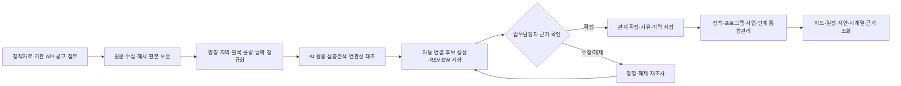
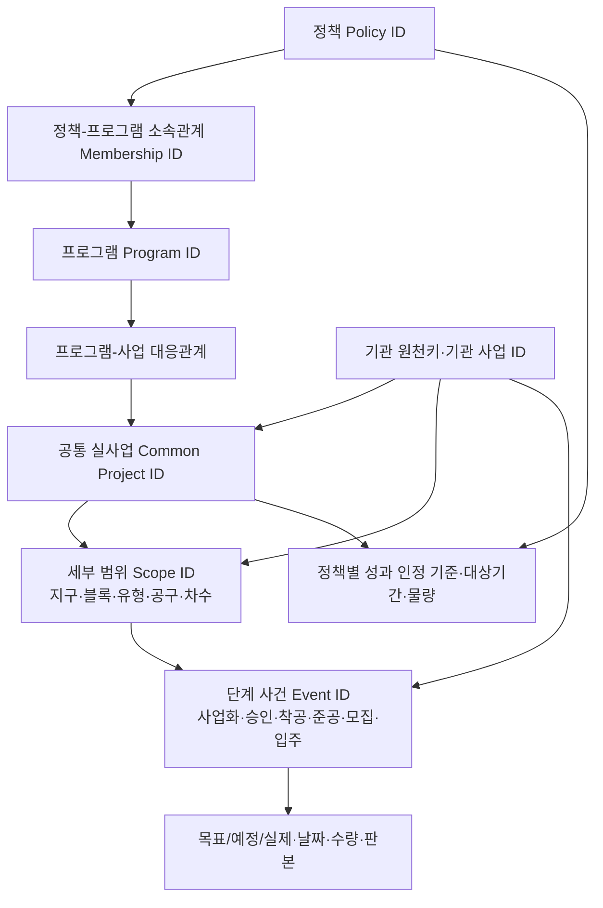

# 연결되지 않은 정책을 연결하다
## HOME: AI 기반 주택공급 정책·사업 통합관리 PoC — 발표용 마스터 콘텐츠

> **핵심 메시지**  
> **주택공급 정책의 진행 상황을 한눈에 보려면, 먼저 서로 다른 기관이 관리하는 ‘같은 사업’을 연결할 수 있어야 한다.**  
> HOME은 공통 연결키가 없는 현실에서 AI를 활용해 연관 자료를 심층 대조하고 연결 후보를 생성한 뒤, 업무담당자가 근거를 확인·확정하도록 구성했다. 이를 토대로 정책부터 개별 사업, 착공·분양·입주에 이르는 흐름을 지도 중심으로 통합 관리하는 서비스를 구현했다. 궁극적으로는 이 임시 연결 작업 자체가 필요 없도록 **공통 식별자와 기관 간 데이터·API 표준을 제도화**할 것을 제안한다.

| 구분 | 내용 |
|---|---|
| 문서 목적 | 실제 발표자료 제작자가 논리·근거·사례·기술·성과·평가·정책 제안을 재구성할 수 있도록 제공하는 **콘텐츠 원본** |
| 문서 성격 | 발표 **스크립트·대본·슬라이드별 멘트가 아님**. 핵심 주장과 이를 뒷받침하는 사실·수치·도식·사례를 구조화한 마스터 |
| 시연 대상 | **HOME · Housing Operations Monitoring & Execution** — [서비스 접속](https://www.minslab.kr/poc/home/) |
| 작성 기준일 | 2026-10-15. 별도 날짜가 명시된 수치는 그 시점의 README 점검 기록 |
| 기본 근거 | `README(2).md`, `주택파동_정책근거_및_요구사항_매트릭스.md`, `2기 - 팀별 주제 선정 및 내용.xlsx`의 **「프로젝트 평가기준」** 시트 |
| 범위 | 현재 시연·관리 중심은 **수도권(서울·경기·인천)과 등록 원천 기록**, 특히 **9·7 주택공급 확대방안**의 연결 원장 |

---

# 0. 이 프로젝트에서 입증하려는 것

## 프로젝트의 출발점과 도달점

| 질문 | 프로젝트가 제시하는 답 |
|---|---|
| 왜 만들었는가? | 총리의 반복적인 주택공급 이행점검·통합관리·디지털 상황판 요구를 실제 업무 시스템으로 구현하기 위해 |
| 무엇이 가로막았는가? | 정책 자료, 기관 사업계획, 인허가·공사·모집공고가 **공통 사업 식별자 없이** 각자 관리돼 같은 사업의 단계별 정보를 연결하기 어려웠음 |
| 어떻게 접근했는가? | AI 활용 심층 조사와 명칭·지역·블록·물량·일정 대조로 **연결 후보를 발굴·자동 매칭**하고, 업무담당자가 원문 근거를 보고 확정하는 구조 구현 |
| 무엇을 완성했는가? | 정책–프로그램–사업–단계의 연결 정보를 DB에 관리하고, 지도·시계열·목표 대비 실적·사업 상세·수집 연계·원천 근거를 통합 조회·수정하는 HOME 서비스 |
| 무엇이 우수한가? | 단순 화면 개발이 아니라 **이종 데이터의 동일성 판별·의미 정합성·사람의 검증·이력관리·정책 의사결정**을 하나의 작동 체계로 통합했다는 점 |
| 최종 제안은 무엇인가? | 임시적인 AI 보정의 반복을 줄이기 위해 **정책·프로그램·실사업·세부범위·단계 사건의 공통 ID를 관리**하고, **원천기관 API에 대응키·범위·사건·판본 정보**를 제공하도록 개선 |

## 반드시 남아야 할 세 가지 메시지

1. **정부의 요구는 ‘예쁜 공급 지도’가 아니라 ‘정책이 실제 어디까지 이행됐는지를 설명하고 조치할 수 있는 상황판’이었다.**
2. **우리가 해결한 가장 어려운 부분은 화면이 아니라 데이터의 연결성이다.** AI는 자료의 연관성을 찾아 후보를 만들고, 담당자는 정책·사업·물량의 실제 의미를 검증한다.
3. **PoC의 성공은 종착점이 아니라 데이터 관리체계 혁신의 근거다.** 현재 방식이 가능하다는 것을 실증했으므로, 장기적으로는 사후 매칭이 아니라 최초 생산 시점부터 식별자를 함께 관리하는 방식으로 바꿔야 한다.

---

# 1. 왜 이 서비스를 만들었는가 — 정책 요구에서 출발

## 1.1 총리 요구의 흐름: 단편적 보고에서 실행관리로

제공된 「주택파동 정책 근거 정리」는 주택공급 관련 정부 요구가 **일정관리 → 사업장별 관리 → 범부처 통합관리 → 국민 체감·예측가능성 → 디지털 상황판 공개**로 구체화되는 흐름을 정리한다.

| 요구가 구체화된 시점 | 핵심 정책 요구 | 서비스로 전환한 관리 기능 |
|---|---|---|
| **2026.08.14** 범부처 점검회의 | 사업이 계획 일정대로 이행되는지 반복 점검 | 계획·목표 대비 현재 실적, 일정 및 진도 관리 |
| **2026.08.19** 인천계양 현장점검 | 사업장별 현황판과 기반시설 점검 | 개별 사업 상세조회, 사업 위치와 주변 여건 확인 |
| **2026.09.03** 범부처 점검회의 | 부처별 개별관리만으로는 전체 진행상황을 한눈에 파악하기 어려움 | 관계기관 자료의 정책 단위 통합, 지연·병목 파악 |
| **2026.09.04·09.18** 현장점검 | 공급 예측가능성 제고와 예정 일정 준수 | 모집·준공·입주 예정, 최초 일정 대비 변경·지연 확인 |
| **2026.09.30** 범부처 점검회의 | 사업별 진행상황과 앞으로의 변화를 쉽게 설명하는 디지털 상황판 | 지역·사업·단계·미래 일정·근거를 연결하는 통합 시각화 |

**정책적 해석:** 정보가 기관별로 존재하는 것만으로는 총괄 책임자가 “정책은 계획대로 가고 있는가, 어디가 막혔는가, 누구에게 어떤 조치를 요청해야 하는가”에 답할 수 없다. **목표에서 개별 사업과 그 이행 사건까지 이어지는 관리 단위**가 필요하다.

**근거:** `주택파동_정책근거_및_요구사항_매트릭스.md` §§1–3·9, `README(2).md` §2. 위 날짜·발언의 구체적 원문 확인은 제공된 정책근거 문서의 국무조정실 보도자료 링크를 이용한다.

## 1.2 요구사항을 12개 검증 항목으로 전환

정부 요구와 관리 현장의 필요를 **F-01~F-12**로 정리해, 추상적인 ‘한눈에 보기’를 구체적인 개발·검증 기준으로 바꿨다.

| 요구 영역 | 대응 F-ID | 도달하고자 한 관리 판단 |
|---|---|---|
| **통합 조망** | F-01, F-04, F-08 | 정책→프로그램→사업의 상하 관계와 지역·기관·사업의 추진현황을 한 번에 파악 |
| **이행·일정 점검** | F-02, F-03, F-05, F-06 | 어떤 단계가 도래 목표 대비 부족한지, 원래 일정과 현재 예정이 어떻게 달라졌는지 파악 |
| **문제 해결** | F-07, F-11 | 지연 원인, 영향 물량, 책임기관, 후속 조치까지 연결 |
| **국민 관점** | F-09 | 특정 지역의 향후 모집·준공·입주 예정과 확정 여부를 설명 |
| **신뢰·미래 판단** | F-10, F-12 | 근거·갱신·변경을 추적하고 일정 변화에 따른 시나리오를 비교 |

**핵심 설계 방향:** 단순 수치를 보여주는 시스템이 아니라, **“그 수치는 어느 사업의 어떤 단계에서, 어떤 원문과 기준일로 확인됐는가”까지 역추적할 수 있는 시스템**이다.

---

# 2. 무엇이 문제였는가 — 자료는 있었지만 연결키가 없었다

## 2.1 자료를 모으는 순간 드러난 구조적 단절

실제 사업의 이행 과정을 확인하기 위해 여러 자료군을 수집·분석했다.

| 정보의 생산 위치 | 확보하려는 정보 | 원천이 사용하는 단위·식별 방식 |
|---|---|---|
| 정부 정책·보도자료 | 정책 목표·기간·대상 프로그램 | 정책명·발표일·목표지역·물량 |
| LH·SH·GH·iH 등 기관의 사업·공급계획 | 실제 추진 사업·지구·블록별 계획 | 사업명·지구명·블록명·기관 사업번호 |
| 건축 인허가·필지 원천 | 인허가 승인·변경·대지 | 허가 관리번호·법정동·주소·지번·PNU |
| 건설·준공 관련 자료 | 착공·공정·준공·승인 | 단지·공구·건설사업·공정 기준 |
| 청약·공급·입주 자료 | 분양·모집·입주 일정과 물량 | 모집공고 번호·공고차수·주택유형·공급물량 |

이 데이터들은 **개별 기관·업무에서는 의미 있는 원본**이다. 그러나 정책 단위에서 연계하려고 하면 문제가 생긴다.

- **같은 사업, 다른 이름**: 같은 지구라도 A31/Ab31처럼 표기가 다르거나 단지·블록·공구·임대 유형 이름이 달라진다.
- **같은 사업, 다른 범위**: 건설은 전체 단지, 공급은 임대유형 일부, 공고는 금회 모집분을 기록한다. 수량이 서로 다르다고 다른 사업인 것도 아니고, 합쳐도 되는 것도 아니다.
- **같은 사업, 다른 시점·의미**: 최초 승인·변경승인·착공·준공 예정·사용승인·모집·입주 예정은 서로 다른 행정적 사건이다.
- **기관별 고유키의 고립**: 허가번호나 공고번호는 각 원천 안에서 유효하지만, 이를 정책·프로그램·실사업으로 이어 주는 **공유 대응관계**가 없었다.

### 문제를 한 문장으로

**“자료를 수집할 수 없는 것이 아니라, 수집한 자료가 정책상 같은 사업과 같은 단계의 사실인지 확정할 연결 기준이 없었다.”**

단순 파일 통합이나 SQL JOIN으로 해결할 수 없는 이유도 여기에 있다. **연결키가 없으면 사람이 이름·지역·물량·사건을 조사해야 하고, 조사 방식이 일회성이라면 다음 수집 때 다시 같은 작업이 반복**된다.

## 2.2 프로젝트의 문제 재정의

| 최초에 보인 문제 | 분석 후 확인된 본질 |
|---|---|
| 주택공급 정보를 한 화면에 모을 수 없다 | 기관 간 **공통 사업·범위 식별체계**가 없다 |
| 같은 사업의 수치가 서로 다르다 | 전체/부분·유형·차수·단계 **적용 범위와 사건 의미**가 다르다 |
| 자료가 있는데도 현황이 비어 있다 | 원천 확보와 **사업·단계 연결 완료**가 별개의 상태다 |
| 데이터가 갱신되면 다시 확인해야 한다 | 관계와 판단의 **판본·검토·감사 이력 관리**가 필요하다 |

**중요한 구분:** HOME에는 현재도 `policy_id`, `PRG_…`, `PRO_…`, `HPR_…` 같은 **내부 ID**가 존재한다. 발견한 문제는 ‘ID가 아예 없다’는 뜻이 아니라 **서로 다른 기관이 동일 사업·부분범위·단계 사건을 공통으로 참조할 수 있는 식별자와 대응관계가 없었다**는 뜻이다.

**근거:** README §§1.1, 3.1–3.3, 3.5, 5.1.

---

# 3. 어떻게 해결했는가 — AI 후보 매칭과 업무담당자 확정

## 3.1 현실적으로 실행 가능한 PoC 해법

기관 전체의 원천 시스템과 API를 즉시 수정할 수 없는 상황에서, 프로젝트는 **기존 공개 자료를 최대한 연결하되 책임 있는 최종 판단은 사람이 수행**하는 이중 구조를 채택했다.

**현재 구현의 원칙은 “AI가 찾고, 사람이 확정하고, 시스템이 이력을 보존한다”이다.**



*도식의 ‘AI 심층분석’은 프로젝트 수행 과정의 AI 도구 활용을 표현한다. 현재 애플리케이션은 정규화·규칙 기반 후보와 저장된 검토 상태를 사용하며, 모델명·매칭 확률·AI 정확도 등 별도 확인되지 않은 지표는 전제하지 않는다.*

## 3.2 데이터 연결을 실제 서비스 기능으로 구현한 방식

| 처리 과정 | 핵심 구현 | 왜 중요한가 |
|---|---|---|
| **① 원천 수집** | 기관 API·웹·공식 첨부의 원문, 수집 배치, 조회 범위, SHA-256 해시·리비전 저장 | 출처·기준일·변경 전후 값을 추적 가능 |
| **② 후보 분석** | 지역·지구·블록·별칭·주소·호수·일정·원천 고유키를 대조하고 연결 후보 저장 | 이름이 다르거나 일부 물량만 같은 사업을 놓치지 않도록 지원 |
| **③ 검토·확정** | `REVIEW / CONFIRMED / RELEASED`로 연결관계 관리, 업무담당자가 근거 확인·수정·확정·해제 | AI·자동 규칙이 행정적 동일성과 공식 실적을 독단적으로 판단하지 않음 |
| **④ 구조화** | 정책→프로그램→사업 관계, 사업×단계 근거, 목표·예정·실제·추정·전체/부분 물량 분리 | 이후 정책 이행률과 일정 비교의 분모·범위가 혼동되지 않음 |
| **⑤ 통합 조회** | DB에 저장된 연결을 재사용해 정책·사업 지도, 그래프, 세부 일정, 원천 근거 제공 | 조회할 때마다 전체 자료를 재매칭하지 않고 반복 업무 절감 구조 확보 |
| **⑥ 오류 재처리** | 유형별 오류·누락 분류, 규칙 보완, 유사 사례 재점검, 감사 기록 | 단건 수정에 그치지 않고 동일 오류 재발을 관리 |

**연결은 세 가지 독립 판단으로 관리한다.**

1. 어떤 **프로그램**이 어느 **정책**에 속하는가.
2. 어떤 **실사업**이 어느 **프로그램**에 속하는가.
3. 어떤 **원천 문서·기록**이 그 사업의 어떤 **단계·물량·사건**을 증명하는가.

따라서 하나의 연결을 확정했다고 나머지 관계까지 자동 승인되는 구조가 아니다. 이 판단 분리가 **정책실적 왜곡을 막는 핵심 통제**다.

## 3.3 사람과 AI의 역할 분담

| AI·자동화가 담당하는 영역 | 업무담당자가 책임지는 영역 |
|---|---|
| 여러 문서에서 지명·블록명·수량·일정의 연관성 탐색 | 동일 실사업인지, 전체/부분 관계인지 최종 확인 |
| 표기 차이·누락 의심·단계 불일치 후보 추출 | 정책·프로그램 귀속, 단계 근거 채택·정정·해제 |
| 원천 비교·후보 정렬·반복 자료 처리 | 정책 성과로 인정할 물량과 기준 기간 결정 |
| 오류 유형을 묶고 추가 조사 대상을 제안 | 최초 기준선·기관 목표·병목 및 후속 조치 승인 |

**설계의 성과:** AI를 사람의 판단 대체물이 아닌 **복잡한 자료 대조의 생산성 도구**로 사용했고, 근거·수정사유·승인결과를 이후에도 재사용할 수 있는 **업무 절차**로 연결했다.

## 3.4 시스템 구현의 기술적 토대

- **데이터 저장·공간 처리:** PostgreSQL 16 + PostGIS 3.5. 정책·사업 연결, 위치·필지 후보, 원천 판본 및 감사 기록 관리.
- **서비스 API:** FastAPI·SQLAlchemy 기반 독립 API. 정책·사업·진척·수집 상태·연결 검토·관리자 입력 등 분리.
- **시각화:** HTML/CSS/JavaScript, MapLibre·Three.js. 정책·지역·사업과 목표 대비 실적을 2D/3D 지도와 그래프로 연결.
- **업무 권한:** 공개 조회와 관리자 입력·확정을 구분. 버전 충돌 검사와 감사 이력 보존.
- **운영 재현성:** 수집기·검사·배포·백업·복구 절차와 API 명세를 문서화.

**근거:** README §§1.2, 3.1–3.2, 3.7–3.8, 4.5, 4.8–4.9, 6장.

---

# 4. 어떤 오류가 있었고 어떻게 해결했는가 — 실제 자료로 검증한 핵심 사례

이 사례들은 단순 개발 에피소드가 아니라, **왜 공통 식별자·범위·사건정보가 함께 있어야 하는지**를 증명하는 실증 근거다. 사례별로 **발견된 오류 → 원인 분석 → 개선·적용 → 얻은 설계 원칙**의 순서로 활용한다.

## 사례 A. 평택고덕 A31 — 이름이 달라 동일 사업이 끊어진 경우

- **발견:** 공급·건설 원천에서 `A31`, `Ab31` 등 표기가 달라 단계별 자료 연결이 단절될 가능성.
- **심층 분석:** 지역·지구·명시된 블록, 관련 **690호** 등의 근거를 함께 비교.
- **구현한 해결:** 단순 명칭 치환이 아니라 `evidence_bridge` **연결 후보**를 저장하고, 문서별 근거 역할을 구분.
- **얻은 원칙:** 텍스트 유사도만으로 사업 동일성을 확정해서는 안 된다. **명칭 + 지역/블록 + 물량 + 원문을 함께 검토**해야 한다.

**적합한 증빙:** 연결 전후 관계도, 원천에 등장하는 서로 다른 블록 표기, 업무담당자 검토 화면.

## 사례 B. 성남금토 A-2 — 같은 사업이지만 ‘전체·부분·금회’ 물량이 다른 경우

- **발견:** 건설 원천 **633호**, 국민임대 **438호**, 금회 모집 **219호**의 수치·범위 차이로 정보 연계가 어려웠음.
- **심층 분석:** 공식 자료로 유형별 구성 **438호 + 195호 = 633호**를 대조하고 모집 차수·유형의 포함관계를 분석.
- **구현한 해결:** 전체 사업·임대유형·금회 공급량을 구분해 단계 근거와 일정 연결을 보완.
- **얻은 원칙:** **633 + 438 + 219를 합산하면 잘못된 정책 수치**가 된다. 원천 자료의 ‘호수’가 같은 단위라도 **적용 범위(scope)**가 달라 합계 규칙이 달라진다.

**적합한 증빙:** ‘633(전체) ⊃ 438(국민임대) ⊃ 219(금회 모집)’의 포함관계 도식. 단, 219가 438의 일부라는 맥락은 해당 모집공고 기준이며 전체 물량을 새로 더한 값이 아님.

## 사례 C. 과천주암 C2 — 인허가의 전체 물량과 공급유형의 일부 물량이 다른 경우

- **발견:** 인허가 원천 **1,030호**와 행복주택 **344호**의 범위·명칭 차이로 자동 연결이 제외되거나 부정확해질 수 있음.
- **심층 분석:** 블록 명칭을 정규화하고, 승인 원천 전체량과 공급 대상 부분량을 구분.
- **구현한 해결:** 같은 블록의 **원천 1,030호 / 해당 근거 적용 344호**를 별도로 보존하도록 연결 규칙 보완.
- **얻은 원칙:** 자료를 연결할 때는 같은 사업인지만큼 **어떤 물량을 어느 단계의 실적으로 인정하는가**가 중요하다.

**적합한 증빙:** 인허가 원천과 공급유형 자료의 대응, 원천량과 적용량이 분리된 상태.

## 사례 D. 공고를 수집했는데 입주 일정이 없는 경우 — 목록과 상세정보의 차이

- **발견:** LH 공고 ‘목록’에는 상세 HTML에 있는 유형별 물량·입주 예정 정보가 나타나지 않아, 수집 완료로 오인하기 쉬웠음.
- **구현한 해결:** 목록→상세 연결 수집, 상세 HTML 추출, 원문 해시·판본 저장. 수집 대상 유형·지역 및 페이지 완결성 검증 확대.
- **얻은 원칙:** **수집 성공 ≠ 필요한 필드 확보 ≠ 동일 사업 연결 완료**다. 수집 품질을 단계별로 점검해야 한다.

## 사례 E. 날짜·단계의 의미를 잘못 해석한 경우 — ‘준공 예정’을 ‘공급’으로 볼 수 있는가

- **발견:** 예상 준공일이 공급 계획에도 표시되는 단계 분류 혼동 발생.
- **구현한 해결:** 준공 예정은 **건설 단계의 사건**으로 일원화. 착공~준공 공정 추정과 실제 공정 관측을 분리.
- **얻은 원칙:** **착공·준공·분양·입주는 서로 다른 사건**이며, 한 사건의 날짜를 다른 사건의 실적으로 대입해서는 안 된다.

### 오류 해결의 공통 성과

- **이름의 유사성 → 근거를 대조한 후보 관계**로 전환.
- **수치의 단순 합산 → 전체/부분의 포함관계를 반영한 적용량**으로 전환.
- **날짜의 혼용 → 원천 예정·승인 목표·실제 사건·추정의 구분**으로 전환.
- **단발성 수동 보정 → 연결 후보·판본·검토 이력·공통 규칙의 반복 활용**으로 전환.

위 사례의 ‘보완·연결 후보 저장’은 실제 적용된 작업이며, **모든 후보가 개별 기관으로부터 공식 확정됐다는 의미는 아니다.** 이러한 신중한 판정 체계 자체가 서비스의 장점이다.

**근거:** README §§3.3, 3.5–3.6.

---

# 5. 그 결과 무엇을 만들었는가 — 정책 실행관리 서비스 HOME

## 5.1 한눈에 보는 정책과 현장

HOME은 단순한 ‘공급량 통계 모음’이 아니다. **관리 대상의 계층·시간·위치·근거**를 하나의 서비스에 연결했다.

```text
정책 목표 · 기간 · 대상 지역
        ↓
실행 프로그램 · 담당기관 · 연결 사업
        ↓
개별 사업 · 사업지구/블록 · 총량/부분량
        ↓
정책 → 사업화 → 인허가 → 건설(착공·준공) → 공급(분양·모집) → 입주
        ↓
목표 / 최초 일정 / 현재 예정 / 실제 확인 / 추정 / 원천 근거 / 담당자 조치
```

**대표적인 사용 흐름**은 ‘정책 전체의 이행상황 확인 → 지연·주의 지역 확인 → 해당 프로그램·사업 선택 → 현재 단계와 향후 일정 확인 → 사용한 원문·연결근거 및 담당자 조치 확인’이다.

## 5.2 구현 기능을 요구사항 관점에서 정리

| 구현된 기능 | 화면·업무에서 확인할 수 있는 것 | 충족시키는 정책 요구 |
|---|---|---|
| **① 지도 중심 통합 현황** | 수도권→시군구→지구·블록·사업의 공간적 탐색, 2D/3D 전환, 선택 범위의 단계·물량 연동 | 한눈에 보는 통합 상황판, 사업장별 밀착관리 |
| **② 정책–프로그램–사업 관리** | 정책 목표와 프로그램·사업 연결, 지역별·단계별 진행상황 | 정책 이행의 책임 구조와 정책 목표 추적 |
| **③ 6단계 흐름·시계열** | 정책·사업화·인허가·건설·공급·입주 단계의 목표·계획·측정·예정, 월/연도 변경 | 현재 진척·미래 공급의 예측가능성 |
| **④ 일정·지연·병목 점검** | 최초 기준선·현재 예정·실제 사건, 도래 목표 대비 부족, 원인·기관·조치·기한 관리 | 약속 일정 준수, 병목의 조기 발견 및 후속 조치 |
| **⑤ 개별 사업 상세·입지 정보** | 사업 개요·공정·모집·준공·입주 일정, 주변 교통·교육·시설, 인구·가구·재고·시장 지표 | 현장 중심 관리, 국민·정책담당자에게 설명 가능한 정보 |
| **⑥ 데이터 수집·연계 검토** | 원천 상태, 사업×단계 근거, 연결 도식, 후보·확정·해제·오류 조치 이력 | 자료의 신뢰성과 연계 업무의 지속 가능성 |
| **⑦ 담당자 정보관리** | 정책·프로그램·사업의 목표·귀속·일정·진행·조치의 수정, 근거·감사 이력 | PoC를 넘어 실제 관리업무에 활용할 수 있는 운영 절차 |
| **⑧ 시나리오 및 보고서 데이터** | 일정 이동 가정의 기준/대안 비교, 조회 조건·수치·원천을 포함한 분석용 MD 내려받기 | 공급 전망 비교, 외부 AI 분석·정책보고 지원 |

### 지도 중심 설계의 차별성

일반적인 통계 대시보드처럼 차트가 여러 개 모여 있는 화면이 아니라, **한 지도를 중심으로 정책과 사업이 어디에서 어떻게 진행되는지**를 확인하고, 선택한 지역·사업에 따라 그래프·근거·입지 정보가 함께 변하도록 설계했다. 지리적 분포와 단계별 흐름을 **같은 맥락에서 판단**하게 하는 것이 핵심이다.

### 이행 판단의 일관성

- 부족량 = `max(0, 도래 목표 − 최근 측정값)`.
- 부족률 **2% 이상은 ‘지연’**, 0% 초과~2% 미만은 ‘주의’로 구분.
- 목표·측정자료가 없어 비교할 수 없으면 ‘미확보/판정 보류’로 관리하고, **자료가 없다는 이유만으로 0호·지연으로 만들지 않음**.
- 누적 단계 도달량과 그 단계에 머물러 있는 물량을 구분해 단계 간 중복 합산을 방지.
- 정책 목표와 연결된 사업 기록의 소계를 **같은 모집단이라고 가정하지 않고** 비교 범위를 명시.

이는 단순 시각화 기법이 아니라 **정책 관리 숫자가 갖춰야 할 계산·판정 원칙**이다.

**근거:** README §§2, 3.3, 4.1–4.5, 4.10–4.11.

## 5.3 시연에서 확인할 핵심 화면과 이동 경로

| 보여줄 핵심 성과 | 서비스 화면 | 시연에서 확인할 사실 |
|---|---|---|
| 정책 전체의 진척과 관리 판단 | [정책 추진현황](https://www.minslab.kr/poc/home/#policy-progress) | 정책 목표, 지역별 단계 진행, 목표 대비 측정값·부족, 관련 통계 |
| 공간 중심 공급현황 | [공급 지도](https://www.minslab.kr/poc/home/#overview) | 지역→블록→사업 연결, 물량·단계·입지 선택 연동 |
| 사업 단위의 실체 | [사업 추진현황](https://www.minslab.kr/poc/home/#projects) | 사업화부터 입주까지 일정·물량·공정·원천 근거 |
| ‘연결’이라는 본 프로젝트의 핵심 기술 | [정책–프로그램–사업 연결](https://www.minslab.kr/poc/home/#tree) | 관계별 후보·선택·검토·승인과 관리 업무 |
| 수집 데이터를 신뢰 가능한 관리 데이터로 변환 | [사업별 수집·연계](https://www.minslab.kr/poc/home/#project-collection) | 사업×단계 수집현황, 연결 도식, 원문·오류·조치 이력 |
| 요구사항에 대한 구현 증빙 | [요구사항정의](https://www.minslab.kr/poc/home/#requirements) | F-01~F-12 세부 기능 구현 평가 및 데이터 확보 현황의 분리 |

**시연의 중심은 ‘지도 화면이 멋있다’가 아니라 ‘지도에서 선택한 정책·사업이 실제 원천·검토이력까지 연결된다’는 점이다.**

---

# 6. 결과를 무엇으로 증명할 것인가 — 기능·데이터·검증 성과

## 6.1 요구사항으로 검증한 기능 완성도

README의 **2026-10-15 요구사항 자체 재검증**에 따르면 다음과 같다.

| 검증 지표 | 결과 | 의미 |
|---|---:|---|
| 검증 대상 | **12개(F-01~F-12), 세부 기능 61개** | 총리 요구 기반 기능을 세부 검사 단위로 구조화 |
| **기능 자체 점검 충족률** | **95.9% (58.5/61점)** | 세부 기능에 충족 1점·부분 충족 0.5점·미구현 0점 적용한 자체 평가 |
| 세부 기능 판정 | **56개 충족 · 5개 부분 충족 · 0개 미구현** | 기능의 구현 상태를 확인한 결과 |
| 판정 기록 | `HOME-REQ-20261015` | 항목별 이유·근거·화면·CSV로 추적 가능 |

**발표의 강점:** 단순히 “기능을 많이 만들었다”고 설명하는 대신, **정책 요구 → 기능 항목 → 구현 화면 → 검증 근거**까지 연결한 결과물이라는 점을 제시할 수 있다.

※ **95.9%는 기능 구현 상태의 자체 점검값**이다. AI 매칭 정확도나 정책 이행률이 아니며 외부 평가위원의 점수도 아니다.

## 6.2 서로 다른 원천을 연결·관리할 수 있는 기반 확보

README의 같은 날짜 점검값을 사용한 대표 지표는 다음과 같다.

| 데이터 기반 지표 | 확인값 | 보여주는 성과 |
|---|---:|---|
| 등록된 9·7 관련 원천 사업 기록 | **197건** | 각 원천을 정책 분석·연결 관리의 대상 레코드로 등록 |
| 사업화~입주의 5단계 관리 셀 | **985개(197×5)** | 사업별 단계 근거를 일관된 구조로 추적할 수 있는 관리 단위 형성 |
| 원천 링크·기준일을 가진 사업 기록 | **197/197 · 100.0%** | 저장된 사업 레코드의 출처와 기준시점을 확인할 수 있는 기반 |
| 사업명·지역·계획량을 가진 기록(추정 제외) | **190/197 · 96.4%** | 통합 조회를 위한 기본 정보 확보 |
| 날짜가 있는 단계 계획을 가진 사업(추정 제외) | **189/197 · 95.9%** | 단계별 일정·미래 공급 흐름을 구성할 수 있는 근거 확보 |

**자료 숫자의 해석:** 197건은 **원천 사업 기록 수**이며 중복된 실사업을 포함할 수 있다. 985개는 단계별 *관리 셀*의 개수이며, 985개의 공식 실적이 확정됐다는 의미는 아니다. 메타데이터 확보율은 사업 동일성 확정률과 다르다. **이 점을 분리해 설명할 수 있는 것이 오히려 자료 관리체계의 완성도를 보여준다.**

## 6.3 품질을 실제로 확인하는 검증 체계

**검증의 초점은 ‘화면이 뜨는가’에서 ‘같은 원천을 넣으면 같은 판단이 재현되는가’까지 확장됐다.**

- **실제 오류 재현:** A31 명칭 차이, 금토 전체/부분, 주암 승인/임대, 공고 상세 누락, 단계 오분류 등 사례 기반 원인·개선·재점검.
- **단계·판정 계산:** 목표와 실적의 비교 범위, 2% 경계, `null/0/미정/미확보` 구분, 단계별 집계와 중복 제외.
- **변경 보호:** 검토 확정·해제 보존, 원천 판본·해시, 담당자 변경 전후 값, 재실행 시 중복 연결 방지.
- **자동·수동 검증:** 요구사항·API·수집·지도·시각화·권한·백업 관련 테스트와 실제 서비스 조회 확인.
- **재검증 기록:** README §8.2는 2026-10-15 요구사항 점검 과정에서 Python unittest **57건**, 추가 기능 pytest **37건**(별도 subtest 24건), Node **18건**과 읽기 전용 운영 화면·CSV·390px 화면 등을 확인한 기록을 명시한다. 이는 **해당 점검 범위의 검사 기록**이지 AI 매칭 정확도 측정값은 아니다.

**핵심 성과 정리:** 정책 요구를 서비스 기능으로 바꾸고, 자료 연결 오류를 **재현·분류·수정·검증 가능한 문제**로 관리하는 체계를 확보했다.

**근거:** README §§2.1–2.2, 3.5–3.6, 8.2.

---

# 7. 왜 우수한 프로젝트인가 — 평가 기준에 따른 객관적 강점

평가표는 **기술부채 관리, 검증 가능성, 기술적 도전성, 현장 적용성, 팀 내재화**의 5개 영역을 각 1~5점, **총 25점**으로 평가한다. 이 프로젝트의 우수성은 아래와 같이 **실제 구현과 검증 가능한 증거**를 중심으로 제시한다. 여기서 평가항목별 점수 자체를 임의로 부여하지는 않는다.

## 7.1 ① 기술부채 관리 — 핵심 구조와 판단을 설명 가능한 기술로 구현

**평가 기준:** 핵심 기능 2~3개의 입력→처리→판단→출력을 설명할 수 있고, AI가 수행한 판단과 사람이 수행한 판단을 구분할 수 있는가.

**HOME의 강점**

| 핵심 로직 | 입력 | 처리와 판단 | 출력 |
|---|---|---|---|
| **사업 동일성 후보 매칭** | 기관별 사업명·블록·원천키·물량·일정·원문 | 정규화·대조 후 후보 저장, 담당자 동일성·범위 확인 | 정책–프로그램–사업 연결 및 검토 이력 |
| **단계 이행·지연 판단** | 정책/사업 목표·도래일·단계별 측정값 | 같은 범위의 목표와 실제를 비교, 2% 경계·미확보 처리 | 지역·단계별 정상/주의/지연과 부족량 |
| **원천 추적·변경 관리** | 원문·수집배치·해시·리비전·담당자 수정 | 최신/이전 판본과 확정·추정·해제 관계 구분 | 출처가 남는 관리 숫자, 근거 팝업, 감사 이력 |

**우수성의 이유:** 기술 선택과 판단 기준을 **DB 구조·코드 모듈·README·검증 항목**으로 설명할 수 있도록 구성했다. AI의 판단에 종속되는 블랙박스가 아니라 담당자에게 책임 소재가 명확한 구조다.

**증빙 위치:** README §§3.1–3.3, 3.8, 4.5, 8.1–8.2; 연결 관리 및 수집·연계 화면.

## 7.2 ② 검증 가능성 — 실제 실패 사례를 구조화하고 재발 방지에 활용

**평가 기준:** 성공·실패 사례와 오류 분석, 검증 방법, 사람이 확인한 근거 및 한계를 제시할 수 있는가.

**HOME의 강점**

- **대표 실패 사례가 실제 원천에 기반**한다: A31/Ab31, 금토 633·438·219, 주암 1,030·344 등.
- **오류의 원인을 일반화**했다: 이름·동일성, 전체/부분 범위, 단계·일정, 수집 누락, 위치·필지 불일치.
- **재발 방지 규칙과 업무 절차가 있다**: 후보 저장→담당자 검토→오류 유형화→유사 사례 보완→재점검.
- **근거를 남긴다**: 원문 판본·SHA-256·선택된 단계 근거·검토 사유·감사 이력.
- **자동 검사와 실제 화면 검증을 병행**한다: 요구사항 자체 재검증, API·JavaScript 테스트, 지도·입력·원천 샘플 확인.

**우수성의 이유:** 그럴듯하게 보이는 매칭 결과를 그대로 받아들이지 않고 **잘못 합쳐질 수 있는 구체적인 사례를 발견하고 규칙으로 개선**했다. 검증이 결과 설명의 부속이 아니라 기능 설계 자체에 포함돼 있다.

**증빙 위치:** README §§3.5–3.6, 8.2; 오류 조치 상세·사업×단계 근거 화면.

## 7.3 ③ 기술적 도전성 — 단순 대시보드를 넘어 다원천 ‘동일성·의미’ 통합에 도전

**평가 기준:** 익숙한 웹서비스 구현을 넘어 어려운 기술적 과제를 정의하고 새로운 접근을 적용했는가.

**HOME의 강점**

- **정책 문서·기관 계획·인허가·건설·모집·입주**를 서로 다른 데이터 모델에서 연결.
- **동일성(Entity Resolution)과 범위(Scope) 문제를 함께 해결**: 단지 전체와 유형·공고차수의 부분 물량을 별도로 관리.
- **시간적 의미 통합**: 최초·변경 승인, 착공·공정·준공·분양·입주 예정과 실제 사건을 구분.
- **공간정보와 정책 흐름의 결합**: 사업·블록 위치와 2D/3D 지도, 지역여건, 단계별 진행을 연동.
- **AI 활용과 행정 통제의 결합**: 연결 후보 생성의 생산성을 확보하면서 관계 승인·정책 성과 인정은 담당자에게 부여.

**우수성의 이유:** 기술적 핵심 난제는 지도 애니메이션이 아니라 **관계가 없는 데이터를 설명 가능한 정책 실행 데이터로 바꾸는 과정**이다. 특히 ‘같은 사업인데 물량이 다른 상황’을 다루는 범위 모델링은 단순 텍스트 검색·엑셀 병합을 넘어선다.

**증빙 위치:** README §§3.1–3.5, 4.3, 5.1–5.2.

## 7.4 ④ 현장 적용성 — 실제 업무 흐름과 운영 절차를 갖춘 PoC

**평가 기준:** 다른 사람이 실제 자료로 실행·조회·관리할 수 있고 실행·설치·운영 조건을 확인할 수 있는가.

**HOME의 강점**

- **접속 가능한 시연 서비스**와 정책·사업·수집 관리 메뉴 제공.
- 정책 담당자는 목표·이행·지연을, 사업 담당자는 개별 단계·일정을, 데이터 담당자는 원천·연결 근거를 확인할 수 있음.
- **공개 조회 / 관리자 확정·수정** 권한을 나누고 변경 사유·이력을 남기는 실무형 기능 구현.
- 정책·프로그램·사업·지역 범위에 따라 결과를 조회하며 **CSV 및 분석용 MD**로 다른 업무·AI 분석에 활용 가능.
- **API 구조, Docker 실행환경, 수집·배포·백업·격리 복원·검사 절차**를 README에 명시.

**우수성의 이유:** 일회성 시연 영상이 아니라 데이터의 수집·수정·재조회와 서비스 유지관리까지 고려한 **실무자가 인계받을 수 있는 작동 단위**로 구현했다.

**증빙 위치:** 서비스 실화면, README §§4.1–4.9, 4.11, 6장, 8.3.

## 7.5 ⑤ 팀 내재화 — 복잡한 구현을 재현 가능한 공유 자산으로 구조화

**평가 기준:** 팀원들이 핵심 구조를 공유하고 특정 개인의 PC·지식에 종속되지 않도록 실행·수정·운영 지식을 남겼는가.

**HOME의 강점**

- 원천 수집·연결·단계 계산·지도·보고서·권한 등 **역할별 코드와 API 책임 지점** 정리.
- **사용자 매뉴얼·업무담당자 매뉴얼·유지관리 매뉴얼·기관 연계 기준**의 공통 원본을 README로 관리.
- 환경변수·배포·원복·DB/원문 분리 백업·격리 복원·회귀검사 절차 문서화.
- 오류 사례·판단 규칙·향후 기관 협의 필드를 기록해 **구현자 외의 사람도 핵심 의도를 이해할 수 있는 기반** 구축.

**우수성의 이유:** 결과물과 함께 **왜 그렇게 설계했는지, 어떤 자료가 필요하며 어디를 수정해야 하는지**를 축적했다. 이는 프로젝트 지속성과 인수인계를 위한 중요한 성과다.

**증빙 위치:** README §§6, 7.2, 8.1–8.3. 팀원별 직접 실행·수정 경험이나 2명 이상 설명 실적은 발표자가 실제 팀 활동 증빙이 있을 경우에만 추가한다.

## 7.6 평가 기준별 핵심 증빙 한 장으로 요약

| 평가 기준 | HOME의 대표 장점 | 가장 설득력 있는 증거 |
|---|---|---|
| **기술부채 관리** | 판단 로직·데이터 구조가 설명 가능 | AI 후보 생성→담당자 확정→정책 집계의 데이터 흐름 |
| **검증 가능성** | 실제 오류에서 검증 규칙을 만들고 반복 점검 | A31·금토·주암 사례, 원문/판본/오류 이력, 관련 테스트 |
| **기술적 도전성** | 관계 없는 원천을 동일성·범위·사건 단위로 통합 | 정책–프로그램–사업–단계 모델과 지도 연계 |
| **현장 적용성** | 시연 가능한 서비스와 관리·운영 절차 | 정책/사업 화면, 관리자 검토, API·배포·복구 매뉴얼 |
| **팀 내재화** | 지식·코드·운영 기준을 문서화 | 모듈별 책임 위치, 재현 절차, 인수인계 자료 |

---

# 8. PoC를 통해 얻은 가장 중요한 결론

## 8.1 현재 방식은 필요한 최선의 보정이지만, 근본 해결은 아니다

**AI 심층 분석을 통한 후보 매칭 + 업무담당자 검증**은, 현재처럼 기관마다 사업 식별체계가 달라 원천 시스템을 곧바로 수정하기 어려운 상황에서 실행 가능한 방법이다. HOME은 그 방식으로 연결 가능성을 검증하고 정책 관리 화면까지 구현했다.

그러나 데이터가 새로 생산될 때마다 **명칭·위치·물량·일정에 대한 추론과 대조를 반복**해야 한다면 인력·시간이 지속적으로 들고, 기관 간 동일성 판단의 통일성을 확보하기 어렵다.

### 핵심 진단

> **문제는 AI가 충분히 똑똑하지 않아서가 아니다. 기관이 처음부터 연결할 수 있도록 데이터를 생산·관리하지 않았기 때문이다.**

따라서 프로젝트의 최종 제안은 “더 강한 AI로 자동 매칭하자”에서 끝나지 않는다. **AI에 의존해 사후적으로 연결하던 관계를 행정 데이터의 기본 속성으로 만들자**는 것이다.

## 8.2 사후 데이터 결합에서 사전 연결성 확보로

| 현행 — PoC가 보완한 방식 | 개선 방향 — 제안하는 관리체계 |
|---|---|
| 기관별 명칭·문서·숫자를 AI·규칙으로 대조 | 원천 생산 시 **기관 고유키와 공통 실사업 ID**를 함께 제공 |
| 다른 범위의 수치를 수작업으로 대조 | 단지·블록·유형·공구·공고차수에 **범위 ID**를 부여 |
| 단계 정보를 문장에서 추출·분류 | 허가·착공·준공·모집·입주 등에 **사건 ID·사건 유형** 부여 |
| 정책 귀속을 별도 조사·검토 | 정책·프로그램과 사업의 **관계·유효기간·인정물량**을 관리 |
| 정정공고·변경계획을 사후 재해석 | **정정/취소/변경판 ID 및 선행 기록 참조**를 제공 |
| 원천 의미가 달라 대시보드 집계가 어렵다 | 목표·예정·실제·추정, 전체/부분, 자료 기준일을 표준 필드로 관리 |

**중요:** 이 표의 오른쪽은 **이번 PoC로 확인한 제도·정보시스템 개선 제안**이며, 원천기관이 이미 모두 도입한 기능으로 설명하지 않는다.

---

# 9. 최종 정책 제안 — 주택공급 데이터의 공통 식별체계와 API 표준 마련

## 9.1 제안의 목표

**정책이 만들어지는 순간부터 사업화·인허가·건설·공급·입주에 이르기까지 같은 정책과 사업을 일관되게 식별하고, 기관별 사건을 자동으로 연결할 수 있는 관리체계**로 전환한다.

단순히 `policy_id` 열 하나를 모든 원천에 추가하는 수준으로는 부족하다. 한 정책에 다수 사업이 있고, 한 사업은 블록·유형·공구·회차로 나뉘며, 여러 정책의 대상으로 동시에 관리될 수도 있기 때문이다.

## 9.2 제안하는 데이터 구조



*기관과 공유할 미래 기준정보의 개념도. HOME의 현행 데이터베이스 ERD를 그대로 나타낸 것은 아님.*

| 표준화할 식별·관리 단위 | 제안할 주요 필드 | 관리 목적 |
|---|---|---|
| **정책** | 공통 정책 ID, 목표·지역·기간·지표 | 정책 목표와 변경 이력 유지 |
| **프로그램·정책 소속** | 공통 프로그램 ID, `membership_id`, 유효기간 | 프로그램의 정책 관계와 귀속 기간 구분 |
| **실사업** | `common_project_id`, `agency_code`, `agency_project_id` | 이름이 바뀌어도 같은 사업을 안정적으로 식별 |
| **전체/부분 범위** | `scope_id`, `parent_scope_id`, 주택유형·공구·공고차수·적용물량 | 전체 건설량과 부분 임대/분양·회차 물량의 중복 차단 |
| **원천 대응관계** | `source_system_id`, `source_record_key`, 연결 대상·관계 상태 | 각 기관의 기존 키를 공통 사업·범위·사건으로 연결 |
| **단계 사건** | `event_id`, 단계·사건유형, `value_kind`, 사건일·수량 | 인허가·착공·준공·분양·입주 사건을 동일 구조로 추적 |
| **정책 성과 인정** | `metric_code`, `recognized_quantity`, 대상 기간, `counting_group_id` | 하나의 사업이 여러 정책에 연결될 때 성과 중복 산입 방지 |
| **판본·정정** | `source_version`, `operation`, `replaces_event_id` | 변경·취소·정정 이력 추적 |
| **검토·상태** | `review_status`, `data_status`, 확인 기관·일자·근거 | 자동연결 후보와 업무담당자 확정, 결측 원인을 구분 |

**설계 원칙:** **사업 식별자 + 범위 식별자 + 단계 사건 + 정책 귀속/성과 인정**이 함께 있어야 정책관리용 통합 데이터가 된다.

## 9.3 API에서 바꿔야 할 사항

기관별로 운영 중인 API나 제공 파일을 일괄 교체하는 방식보다, 기존 원천 고유번호를 유지하면서 **연계를 위한 공통 필드**를 단계적으로 추가하는 접근을 제안한다.

| 제공기관·자료 | 현재 활용할 수 있는 키 | API/제공 데이터에 추가·확대할 핵심 필드 |
|---|---|---|
| **정책·프로그램 총괄** | 정책 원문·내부 정책/프로그램 ID | 공통 정책/프로그램 ID, 대상 사업 명부, 정책별 인정 기준·목표·기간 |
| **LH·SH·GH·iH 등 사업관리기관** | 기관 사업번호·지구/블록·단지명 | 기관 사업 ID↔공통 실사업·범위 ID 대응표, 실제 공정·입주 사건, 변경 일정 |
| **인허가 정보 제공기관** | 허가 관리번호, 대지·동·주소 정보 | 허가 사건↔사업/범위 대응 ID, 최초/변경/취소 구분, 사건 날짜와 인정 물량 |
| **건설·준공 관련 원천** | 공사·대장·사용승인 번호 | 건설·준공 사건 ID, 사업/범위 키, 공정·완료일·변경 계보 |
| **모집·분양 정보 제공기관** | 주택관리번호·공고번호·상세 ID | 공통 사업/범위 ID, 회차·유형별 전체량/금회량, 정정·취소, 입주 예정 |
| **지적·공간정보** | 법정동코드·PNU·지구/블록 | 공식 위치·경계, 좌표계·정확도, 필지 분할/합필·유효기간 및 사업 대응관계 |

**API 원칙**

1. 기존 기관 고유키를 삭제하지 않고 공통키와 함께 제공한다.
2. 연결 대상은 **실사업 전체인지, 블록·유형 등 부분범위인지** 명시한다.
3. 사건의 **목표/예정/실제**, 최초/변경/취소, 기준일·판본을 구분한다.
4. 하나의 공고가 여러 사업·유형을 다루면 일대다 상세행 또는 `links[]`를 허용한다.
5. 기관이 정책 귀속을 판단하기 어렵다면 **사업·범위·사건은 원천기관**, **정책 귀속·성과 인정은 정책 총괄기관**이 검토·승인한다.

## 9.4 역할과 책임을 명확히 하는 운영 제안

| 책임 주체 | 제안하는 책임 |
|---|---|
| **정책 총괄 담당자** | 정책·프로그램 ID와 목표·지표 관리, 정책별 사업 귀속·인정 물량 승인 |
| **사업 담당기관** | 공통 실사업 ID 및 기관 사업 ID 대응 확인, 블록·유형·공구 등 범위 관리 |
| **단계별 원천 생산기관** | 허가·착공·준공·모집·입주 사건 ID, 날짜·물량·판본·정정 내역 제공 |
| **기준정보 관리 주체** | 공통 등록부, 명칭 변경·분할·통합 계보, 코드·인터페이스 표준 운영 |
| **통합관리 서비스** | 기관 데이터를 공통 식별자로 연결하여 계획·실적·지연·근거·조치를 통합 제공 |

### 단계적 전환 방안

1. **PoC 성과 확산:** HOME의 연결 후보·확정·오류 사례를 활용해 공통 연결키의 필요성과 실제 필드 요건을 합의한다.
2. **공통 기준정보 확립:** 정책·프로그램·실사업·범위 등록부와 기존 기관 ID 대응표를 확정한다.
3. **원천기관 API 개선:** 공통 사업·범위·사건 키, 날짜·물량 의미, 정정·판본 정보를 제공하도록 표준화한다.
4. **통합관리 고도화:** 기존 PRO/HPR·원천 판본·감사 이력을 보존하며 공통 ID 기반 집계로 단계적으로 전환하고 전국 확대를 추진한다.

**근거:** README §§5.1–5.5. 제안 필드는 현행 HOME API의 전체 구현 필드 목록이 아니라 **향후 기관 간 협의·표준화할 인터페이스**다.

---

# 10. 이 프로젝트의 실질적인 가치

## 10.1 당장의 가치 — 정책 현황 파악과 업무 수행 방식 개선

- **정책 총괄의 관점:** 어느 지역·프로그램·사업이 정책 목표 달성에 기여하고, 어떤 단계에 점검이 필요한지 연결된 근거로 파악.
- **현장 사업관리의 관점:** 사업 단계와 원래 계획·현재 예정·확인된 사건을 비교하고 관련 문서·후속 조치를 한곳에서 확인.
- **데이터 관리의 관점:** 원천 미확보·연결 미완료·부분 물량·변경 이력을 구분하여 반복 자료 조사와 집계 오류를 체계적으로 관리.
- **국민 안내의 관점:** 지역별 예정 사업과 공급·입주 일정을 쉽게 이해할 수 있도록 위치와 진행 상태를 결합.

이는 확인 가능한 **기능상·업무상 가치**이며, 별도 실측되지 않은 ‘업무시간 00% 단축’이나 ‘정책성과 00% 개선’과 같은 수치를 만들어 붙이지 않는다.

## 10.2 장기적 가치 — ‘사후 취합 행정’에서 ‘연결되는 행정’으로

현재는 각 기관이 만든 데이터를 정책 총괄 조직이 뒤늦게 모으고 **연관성을 추정·확인**한다. 제안하는 미래 체계에서는 원천기관이 처음부터 식별자·범위·사건·판본을 관리하여, 정책 총괄은 **반복 연결 작업 대신 실제 이행점검과 문제 해결**에 집중할 수 있다.

| 현재 구조 | 지향하는 구조 |
|---|---|
| 같은 사업을 데이터 수집 시점마다 다시 찾음 | 기관 간 공통 ID로 자동 연결 |
| 원천의 수량·단계 차이를 사후 해석 | 범위·사건 정의가 생산 시점부터 함께 제공 |
| 정책보고서 작성 때마다 관계를 재정리 | 정책→사업→실적·근거가 상시 연결 |
| 오류 해결 경험이 담당자 개인에게 남음 | 표준 등록부·API·감사 이력으로 조직의 지식이 됨 |

**장기 비전:** **“정책 발표부터 국민 입주까지 이어지는, 근거가 추적되는 주택공급 행정 데이터 연결체계.”**

---

# 11. 결론 — 가장 중요한 것은 지도가 아니라 연결 구조다

이번 프로젝트는 총리의 주택공급 디지털 상황판 요구에서 출발했다. 정책과 실제 공급사업을 하나의 흐름으로 보여주기 위해 정보를 수집하던 중, **기관별 자료 사이에 동일한 사업을 식별할 수 있는 공통 연결체계가 없다는 문제**를 발견했다.

우리는 이를 회피하지 않고 **AI 도구를 활용한 심층 분석·연결 후보 도출 → 업무담당자 검토·확정 → 출처·판본·범위가 남는 DB 관리 → 지도 중심 정책 실행관리 서비스 구현**으로 연결했다. 실제 오류 사례를 통해 데이터의 동일성뿐 아니라 **부분 물량·단계 사건·일정 의미를 구분해야 한다는 사실**까지 확인했다.

그 결과 HOME은 **정책의 목표에서 프로그램·실사업·단계별 현황과 근거까지 연결하는 작동 가능한 PoC**가 됐다. 요구사항 기능 자체 점검 **95.9%**, 명시된 오류 개선·검증 체계, 운영·유지관리 문서와 실제 서비스가 그 결과를 뒷받침한다.

그러나 이 성공 경험이 알려주는 더 중요한 결론은 **매번 AI로 연결을 복구하는 일이 공공행정의 최종 운영 방식이어서는 안 된다**는 점이다. 사후 보정 중심에서 벗어나 정책·프로그램·실사업·범위·사건의 **공통 ID를 담당기관이 생성·검증·관리**하고, 기관 간 **API가 그 식별자와 의미 정보를 함께 전달**하도록 바꿔야 한다.

> ## 최종 제안
> **AI로 연결해 본 지금, 이제는 처음부터 연결되는 행정 데이터 구조를 만들자.**
>
> **화면을 통합한 PoC에서, 정책과 사업을 연결하는 범정부 기준정보 체계로.**

---

# 부록 A. 발표자료 제작자가 사용할 핵심 근거·화면 매핑

이 부록은 발표 스크립트가 아니라, **발표 자료 제작 과정에서 주장에 대응하는 증거를 빠르게 선택하기 위한 색인**이다.

| 핵심 주장 | 객관적 근거·도표로 활용할 요소 | 1차 참조 위치 |
|---|---|---|
| 총리 요구가 ‘실행·사업별·범부처·디지털 상황판’으로 구체화됐다 | 2026.08~09 발언 흐름과 정책 요구 매트릭스 | 정책근거 매트릭스 §§1–3·9 |
| 문제의 본질은 기관 간 공유 사업키 부재 | 원천별 다른 ID·명칭·단계·범위 대응 표 | README §§1.1, 3.1–3.2 |
| AI 후보 매칭과 담당자 최종 판단을 결합했다 | 원천→정규화→후보→REVIEW→확정→DB 연결 다이어그램 | README §§3.1, 3.5, 4.5 |
| 단순 합산을 방지할 수 있는 의미 통합이 필요하다 | 금토 633/438/219, 주암 1030/344, A31 별칭 | README §3.5 |
| 지도 중심 통합관리 서비스를 실제 구현했다 | 정책·지도·사업·사업별 수집연계·관리 화면 | README §4, [HOME](https://www.minslab.kr/poc/home/) |
| 요구사항을 기능 단위로 자체 검증했다 | 12개 항목·61개 세부기능·95.9%, 판정 근거 | README §§2.1, 8.2 |
| 수집 결과에 원천·기준일을 연결했다 | 197건, 985개 단계 셀, 원천 링크·기준일 197/197 | README §2.2 |
| 지속 운영 가능한 단위로 구성했다 | API 목록, 권한·감사, 운영·백업·복원·검증 절차 | README §§4.8–4.9, 6, 8.1–8.3 |
| 근본 해결은 공통 ID·API 필드 추가다 | 현행 vs 보완 데이터 필드, 기관별 제공 항목, 단계별 전환 | README §§5.1–5.4 |
| 프로젝트 평가 기준에서 설명 가능한 성과가 있다 | 5대 평가 기준과 핵심 기술·검증·시연·문서 증빙 | 평가표 「프로젝트 평가기준」 시트 / 본 문서 §7 |

# 부록 B. 성과 표현의 정확성을 지키는 표기 기준

이 항목은 발표의 약점을 나열하기 위한 것이 아니라, **우수한 성과를 과장 없이 설득력 있게 제시하기 위한 최소한의 표현 기준**이다.

| 이렇게 표현한다 | 혼동하기 쉬운 표현 |
|---|---|
| **기능 자체 점검 95.9%(58.5/61)** | AI 매칭 정확도 95.9%, 정책 목표 달성률 95.9% |
| **9·7 관련 등록 원천 사업 기록 197건** | 전국 고유 사업 197개, 전국 사업 모두 통합 |
| **AI 활용 심층 대조·연결 후보 + 담당자 근거 확인** | AI가 모든 사업의 관계를 공식 확정 |
| **전체/부분 범위와 실제 사건을 구분해 저장** | 동일 사업의 모든 원천 물량을 자동 합산 |
| **공통 ID·기관 API 필드 확대를 제안** | 중앙부처·원천기관이 이미 공통 ID 체계를 도입 완료 |
| **시연 가능한 서비스·운영 매뉴얼과 검증 기록 확보** | 실제 기관 전면 도입·공식 정책실적 원장 전환 완료 |

## 최종 근거 문서

1. `README(2).md` — HOME 구현 범위·F-01~F-12·데이터 확보·매칭 오류·관리 기능·DB/API·운영·향후 개선의 1차 기술 근거. **문서 기준일 2026-10-15**.
2. `주택파동_정책근거_및_요구사항_매트릭스.md` — 총리의 정책 요구 흐름, 디지털 상황판 필요성, 핵심 기능 요구 및 공식 보도자료 URL의 근거.
3. `2기 - 팀별 주제 선정 및 내용.xlsx`의 `프로젝트 평가기준` 시트 — ① 기술부채 관리 ② 검증 가능성 ③ 기술적 도전성 ④ 현장 적용성 ⑤ 팀 내재화, **항목당 1~5점·총 25점**.

**발표 콘텐츠의 전체 논리:**  
**정책 요구 → 데이터 수집 → 공통키 부재 발견 → AI 후보 매칭 + 담당자 확정 → 오류 수정·의미 통합 → HOME 구현 및 검증 → 평가 기준상 우수성 → 공통 ID·기관 API 개선 제안.**
